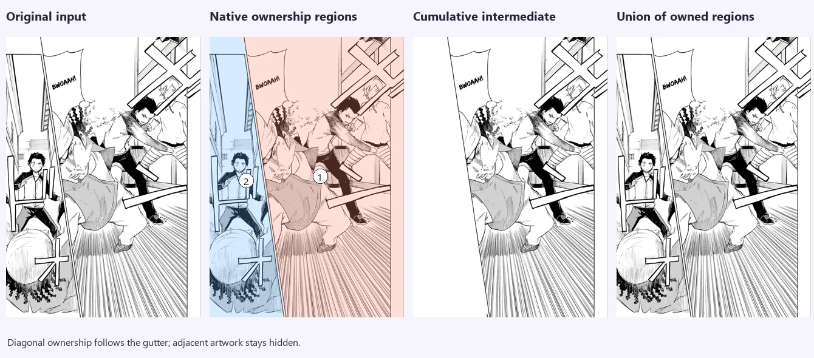

# Suki Manga

面向 Android 的漫画阅读器：把漫画原页划分成**完整阅读区域**，按阅读顺序累积揭晓，保留原画、黑框、框外对白及跨格物体。Flutter 界面 + Java/Kotlin 原生识别 + OpenCV + ExecuTorch 本地推理。

当前公开基线：**0.8.11-preload**，对应作者指定的 `SukiManga-0.8.11-preload.apk`，不是早期 Android 初版。

[下载安装包](https://github.com/mojieRomeo/Suki-Manga/releases/tag/v0.8.11-preload) · [图像案例与标注](docs/GALLERY.md) · [技术实现](docs/ARCHITECTURE.md) · [验证范围](release/VERIFICATION.md)

## 从检测框到完整阅读区域

单纯裁切检测框会漏掉框外对白、截断物体，或者提前泄露相邻画格。本项目在现成模型的候选结果上实现页面几何分析、区域归属、跨格关联和累积呈现。

上图依次为原页、原生识别得到的区域归属标注、中间阅读状态、所有归属区域的并集。图片来自本次原生检查的真实输出重新绘制，**不是手机截图，也不是与旧版本的效果对照**。编号表示区域顺序，关联区域可以在同一步揭晓。

- **复杂页面**：结合模型候选、黑框、开口沟槽、斜线和页面背景，恢复矩形框无法描述的阅读区域；处理斜分镜和框外内容归属。
- **跨格关联**：对白轮廓、人物及连续物体的关联证据用于组合相关分镜，避免只显示半个气泡或切断连续画面。
- **顺序与累积揭晓**：页面结构优先确定上下层，再按从右到左排列；保留已显示区域，只增加当前步骤负责的原图区域。可靠区域页不依赖最后一次操作补出遗漏内容。
- **跨页与不确定页面**：横向大跨页或缺少可靠分格证据时显示整页；不强行切割。跨格关联与跨页整页回退是两种不同处理。
- **非白色纸面**：识别页面的大面积背景，先显示背景，再揭晓画面；保留原色而不统一刷白。
- **阅读体验**：原页等比居中、气泡点击放大、条漫适配屏宽连续滚动、后台下载/解码/识别预加载、识别结果复用和有界缓存。当前普通页手势为向上/向右下一步，向下/向左上一步。

更多框外对白、连续人物和灰底页面实例见 [案例页](docs/GALLERY.md)。这些是可核对的实现与样本结果，不代表对任意漫画都能正确分格。

## 哪些是现成模型，哪些是本项目的处理

| 层次 | 来源与职责 |
|---|---|
| MAGI | [Ragav Sachdeva / Andrew Zisserman 的现成模型](https://github.com/ragavsachdeva/magi)，提供画格、文本和人物等候选；本项目没有从零训练 MAGI。 |
| 气泡精细轮廓 | 采用现成 YOLO 实例分割权重，与 MAGI 候选共同使用；准确气泡轮廓不是全部由 MAGI 单独完成。 |
| Suki Manga 页面处理 | 原生几何修正、框外区域扩展与归属、相邻画格约束、跨格关联、非白纸面分离、区域覆盖以及阅读步骤组织。 |
| Suki Manga 阅读器 | 累积原图渲染、整页回退、条漫分支、气泡交互、预加载调度和缓存。 |

详细模型来源、固定版本及许可见 [第三方声明](THIRD_PARTY_NOTICES.md)。Android 不包含 OCR 或 LaMa 修图流程。本项目的主要工作是模型结果之后的页面处理与阅读呈现，不能把这些样本当作新训练模型的准确率报告。

## 构建与模型

1. 安装 Flutter **3.47.9 stable**（Dart **3.13.7**）、Android SDK 和 JDK 17，完成 `flutter doctor`。
2. 仓库根目录执行 `python tools/fetch_models.py`，下载并校验模型。普通构建无需安装 PyTorch。
3. 在 `app` 执行 `flutter pub get`、`flutter analyze`、`flutter test`、`flutter build apk --release`。
4. 生成 `app/build/app/outputs/flutter-apk/app-release.apk`。最低 Android 9 / API 28，含 arm64-v8a、x86_64。

Gradle 9.3.1 / AGP 9.1.0 / Kotlin 2.4.0 / ExecuTorch 1.5.1 / OpenCV 4.13.0。构建不依赖作者的 C/D 盘路径。默认使用本机调试证书；正式签名参考 `app/android/key.properties.example`。原签名私钥不公开，自建 APK 不能直接覆盖原版签名安装。

模型由已有固定版本 [模型发布包](https://github.com/mojieRomeo/Suki-Manga/releases/download/v0.8.11/SukiManga-0.8.11-models.zip) 提供；它与 preload 版使用的模型相同。12 个文件及 SHA256 固定在 `models/manifest.json`，执行 `python tools/fetch_models.py --check` 核验；离线使用 `--archive <模型压缩包路径>`。

运行必需的 `magi.pte` 与 `bubbles.pte` 放在 `app/android/app/src/main/assets/models/`。源权重及导出代码另行提供，不将模型误当作可删除缓存。重新导出见 `tools/export_executorch.py` 和 `tools/requirements-export.txt`，不保证导出结果逐字节相同。

## 本次验证

2026-11-18：**54 项 Flutter 测试通过、1 项 Node 书源测试通过、静态分析通过、Android release 构建通过、34 个私有原生样本检查通过**。最终 APK 已安装并冷启动。46 个运行源码/资源文件与最终本地工程一致，两个 APK 内模型与固定模型校验值一致，详见 [验证说明](release/VERIFICATION.md) 和 [源码基线](release/source-baseline.json)。

公开测试使用自绘素材；私有漫画测试全集不随仓库发布。回归通过表示这些断言通过，不等于任意漫画准确率，也不保证第三方书源持续可用。构建验证不等于证明当前源码可逐字节重建历史 APK。

## 许可

原创应用代码：**AGPL-3.0-only**。模型、字体和漫画图片保留各自权利。**MAGI 限个人、研究、非商业及非营利用途，商业使用需联系作者**；源码开放不代表整套模型软件可任意商用。案例漫画仅作技术说明，不随原创代码重新授权，见 [THIRD_PARTY_NOTICES.md](THIRD_PARTY_NOTICES.md)。
