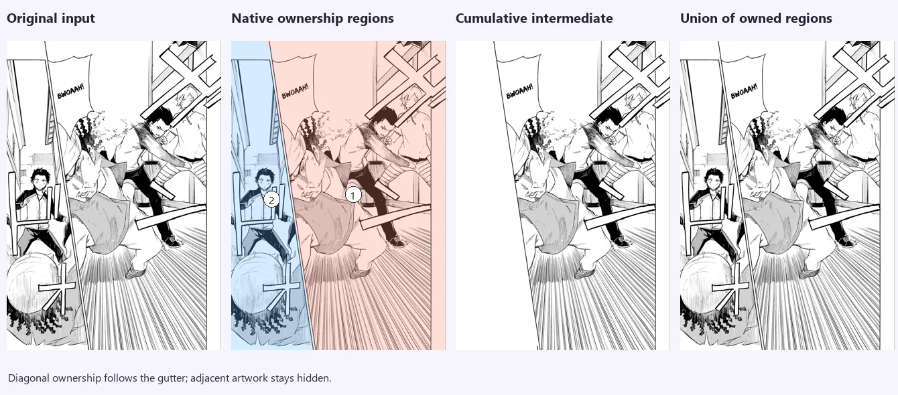
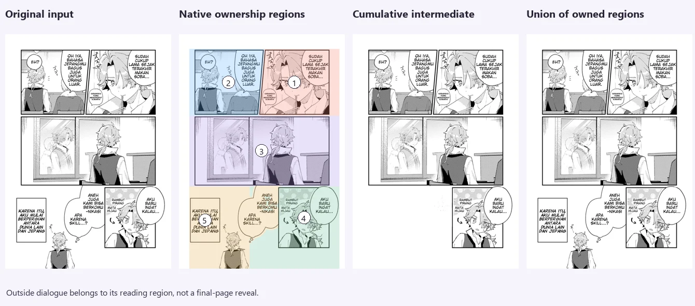
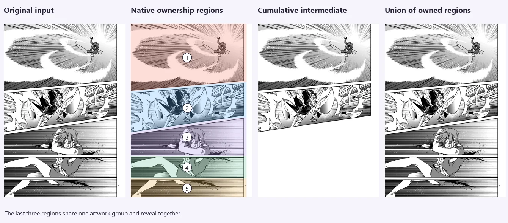
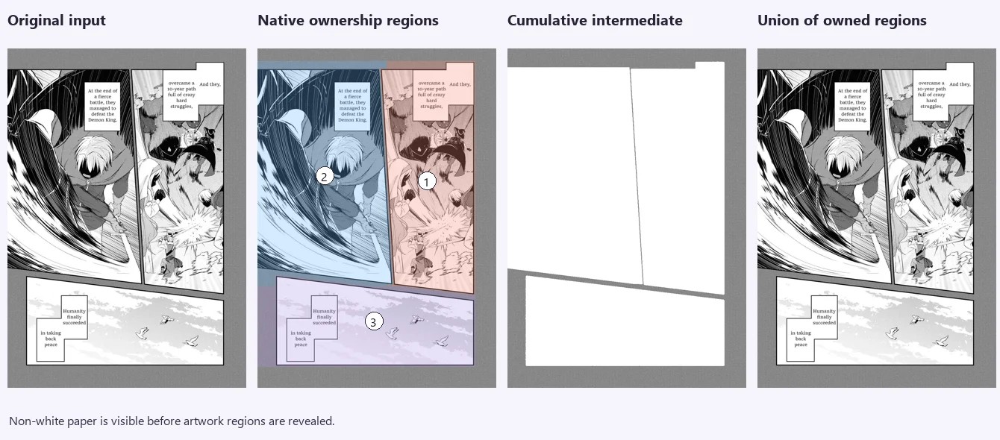

# 页面处理案例

以下四图使用 2026-11-18 在 Android 模拟器上运行原生 `ReaderProbe` 的实际输出生成。原图与其路径标注使用同一坐标系；未人工修补分格结果。左起：原图 → 区域归属 → 累积中间状态 → 全部归属区域并集。编号是区域顺序，不是模型置信度或严格的操作次数；关联分镜可能同一步出现。图片属于各漫画权利人，仅作技术说明。

这不是旧版/新版的定量比较，也不代表完整手机界面。原生样本名称与本次检查结果见 [native-verification.json](../release/native-verification.json)。

## 斜分镜：避免矩形裁切带出邻格

`rezero-12.jpg`：2 个区域。斜向沟槽决定区域边界，中间状态只保留右侧负责的内容；左侧画面在下一归属区域出现。原图线条和拟声字不重新绘制。

## 框外对白：跟随所属区域

`thought-10.jpg`：5 个区域。底部右画格先出现，左侧无框人物、叙述框与思考气泡归入下一完整区域。中间状态为前 4 个区域并集，避免气泡一半或文字提前出现。图示也说明：阅读区域大于可见黑框，并非固定外扩矩形。

## 连续物体：相关分镜组合

`mushoku-15.jpg`：5 个区域，最后 3 个带同一 artworkGroup。上方两个步骤之后，连续人物的后三段共同揭晓；区域仍保留各自几何归属。此规则依赖关联证据，不将所有相邻窄格都合并。

## 非白色背景：先纸面，后画面

`reported-original-gray.jpg`：3 个区域。中间状态只呈现识别的背景路径，然后才按步骤揭晓画面。原生检查还覆盖黑、蓝、深紫、灰、绿、粉、黄背景变体；不能由此推断任意复杂纹理背景都已解决。

## 可核查范围

本次还检查了五条独立横分镜、窄分镜恢复、窗户误检回退、空白页和斜向区域。这里展示的是实际样本行为；未计算人工标注全集上的 IoU、召回率、用户阅读速度，也没有宣称跨漫画的百分百准确率。
